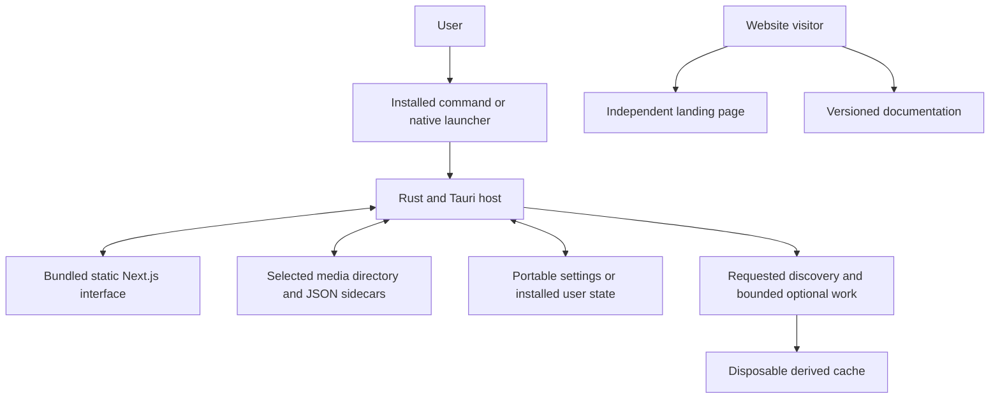

# Architecture

## System context

The system has three delivery surfaces: the installed application, the Lite application placed with a gallery, and the public website. Installed and Lite operation share the gallery's behavioral contracts. The website contains an independent landing page and release-versioned documentation; it does not become the runtime server for a local collection.

**AR-01:** Filesystem access, directory discovery, settings persistence, platform integration and background jobs MUST be owned by the native backend. The interface requests capabilities and presents results; it MUST NOT turn a user-controlled filename or sidecar field into a native instruction.

## Native host and gallery core

The gallery core owns root identity, discovered item records, scan generations, preferences and derived-artifact bookkeeping. It SHOULD be testable independently of the native window. Platform adapters own installation locations, path conventions, executable discovery and OS integration. Host-specific code must not introduce a second definition of sorting, sidecar association or configuration precedence.

The [Tauri process model](https://tauri.app/concept/process-model/) separates native application responsibilities from webview rendering. Platform engines are dependencies rather than user-selected browser applications. A framework's available capabilities do not automatically become product features or required permissions.

**AR-02:** Expensive discovery, metadata inspection and thumbnail work MUST leave the UI event loop responsive. Work MUST be bounded and cancellable at meaningful boundaries. Changing galleries must prevent results from the previous gallery from being applied to the new one. Worker counts and queue limits are release-specific decisions under U-10.

## Interface build and runtime data

**AR-03:** The application interface MUST be built as a static Next.js export and shipped with the native application. Ordinary recipient use MUST NOT require Node.js, npm, a Next.js server, a CDN or a frontend rebuild for each directory. Runtime media and state come from the native host.

Static export produces application assets at build time; features requiring a Next.js runtime server are outside that interface arrangement. Native discovery replaces build-time enumeration of collection items. App screens must not depend on generating one Next.js route for every media file. [Next.js static-export guidance](https://nextjs.org/docs/app/guides/static-exports)

An application's exported interface and the website may share brand bindings and narrowly useful components. Documentation search indexes, syntax highlighting and diagram runtimes SHOULD remain scoped to documentation routes. Their presence on the website is not a reason to put them in a gallery package.

## Data flow and authority

**AR-04:** Current directory observations MUST govern item existence. Portable settings govern intentional shared presentation according to the eventual precedence contract. Sidecars contribute attributed metadata. Machine-local remembered paths assist installed use. Derived caches accelerate work and MUST NOT become the only source from which the collection can be reconstructed.

The host assigns item references to a gallery session and resolves them to authorized filesystem resources. Opening and explicit Refresh produce the authoritative discovery snapshot; idle background scanning and collection polling are disabled. Sorting/filtering operate over that complete discovered record set before bounded pagination, while visible media loads on demand. The transport must avoid copying the entire collection's image/video bytes through ordinary JSON messages. Native media URLs or an equivalent bounded streaming mechanism are specified through [interfaces and contracts](interfaces-and-contracts.md).

Paths must retain their native meaning. Presentation-friendly separators, URI encoding and canonical filesystem identity are different operations. Replacing a drive prefix or applying string substitutions is not sufficient path handling.

## Lifetime and failure boundaries

The application owns the lifetime of its windows, workers, transient media access and state writers. **AR-05:** Closing or cancelling a session MUST stop admitting new work and release resources when in-flight work reaches a safe boundary. Partial scans, cancelled jobs and unavailable directories must remain distinguishable from completed work.

A media decoder or sidecar failure should be attributable to the affected item or task. The unaffected collection remains usable where possible. Multiple processes must coordinate shared writes rather than assuming that only one launcher can be opened. Whether repeated launches reuse a window or create separate sessions remains part of U-08.

## Dependency and build boundaries

Rust, frontend tooling, platform SDKs and build-time verification tools belong to the build environment. Recipients need the release's declared runtime dependencies. Full installation may provision them; Lite must clearly identify its supported-host assumptions. Optional media tools must be accounted for separately from the base application.

The pinned brand contract controls identity and interface bindings. Product-specific screens and navigation remain application code. Use one owner for native/web insets and focus behavior, following [brand integration](brand.md), rather than applying the same host adjustment twice.

## Open decisions

U-01 owns platform runtime and packaging combinations; U-08 owns exact host interfaces and process/session behavior. Rust/Tauri and static Next.js are selected. Specific crate versions, transport details and worker implementations remain engineering work and must not silently settle unresolved product behavior.

Return to the [index](index.md) or consult the [glossary](glossary.md).
