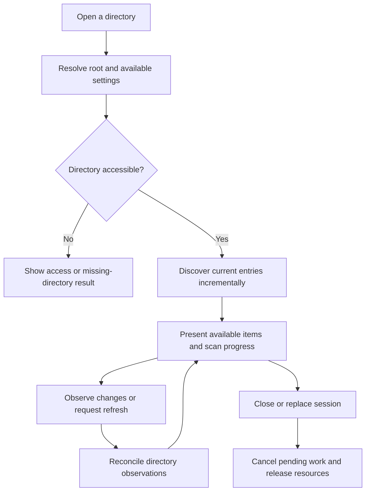

# Gallery lifecycle

## Root selection and identity

A gallery root is the directory selected for one browsing session. An installed command can receive an explicit directory, and the application can offer a native directory chooser. A Lite launcher placed with media must be able to resolve the containing gallery without relying on the sender's machine or the shell's current working directory.

**GL-01:** Root resolution MUST preserve native path semantics and distinguish the gallery location from application internals. A launcher inside a macOS bundle or mounted Linux package must resolve the intended outer gallery location. Explicit selection must take precedence over accidental process working-directory changes. Exact command/default-selection precedence is U-08.

Portable item relationships must be relative to the selected root where appropriate. Absolute paths may be used for current native access and installed remembered-location lookup, but must not become the required portable identity of every file. Display names, relative paths and machine-local file identity serve different purposes; do not collapse them into a single normalized string.

## Opening and discovery

**GL-02:** Opening MUST discover current media without requiring a previously prepared manifest, a thumbnail cache or a remembered-location record. Discovery SHOULD present available results incrementally. Initial discovery must expose whether its result is complete, partial or failed. Empty results must retain enough context to distinguish an empty scope from unreadable entries and active filtering.

An inaccessible child entry must be attributable without discarding successfully discovered siblings. The gallery must tolerate files disappearing, becoming unreadable or being replaced between enumeration and opening. The next valid observation governs whether an item can be loaded. In-progress copies must not be reported as permanently corrupt solely because the first read was incomplete.

**GL-03:** Directory traversal MUST terminate under the selected traversal policy and MUST NOT repeatedly follow a cycle. Recursion, external symlink traversal, nested galleries and mount boundaries require the explicit policy under U-03. An implementation must not accidentally decide those policies through the defaults of a filesystem library.

## Maintaining a current view

**GL-04:** Additions, removals and relevant file changes MUST be discoverable without manual manifest regeneration. While a gallery remains open, the application must update its view automatically using notifications, reconciliation or their combination. A user-triggered refresh provides recovery and must not be the only intended response to ordinary directory changes.

Filesystem notifications are observations that may be delayed, coalesced or missed. Opening/reopening and recovery from a lost watcher must reconcile against directory contents. A refresh must converge even if the previous cache was created elsewhere or there was no previous cache. Completion indicators must distinguish an initial scan from a later reconciliation.

Changes invalidate affected derived data and sidecar associations. The application should preserve selection and browsing position when the selected item still exists. When it disappears, the interface explains the change and chooses a documented neighboring or empty state rather than retaining a playable-looking dead entry.

## Optional preparation

Preparation is a deliberate operation offering portable presentation settings, optional thumbnail generation and optional additional platform binaries. **GL-05:** The user MUST be able to decline thumbnail generation and continue browsing. Preparation must explain which files it intends to add, identify collisions, expose progress and support cancellation where meaningful.

Preparing a gallery does not transfer ownership of its originals to the application. Added artifacts must remain distinguishable from media and arbitrary user sidecars. A partly completed preparation must not prevent fresh discovery. Rerunning preparation should inspect existing owned outputs and avoid duplicating them or replacing unrelated files.

## Relocation, sharing and unavailable roots

**GL-06:** Renaming or moving the containing gallery directory MUST NOT require rebuilding a media manifest. Shared configuration and sidecar associations must be evaluated against the recipient's actual root. Missing caches can be rebuilt or bypassed. The recipient's application does not require access to the sender's per-user state.

For example, a synthetic gallery containing `harbor.jpg`, `harbor.jpg_meta.json`, `clip.mp4` and optional settings can be extracted under a different parent directory and drive. Discovery should locate the current files. A later added `portrait.png` appears automatically; removing `clip.mp4` removes its available media entry without running a preparation command.

Temporary loss of a removable drive or network location is not proof that the user's settings should be deleted. A session should show the unavailable root and allow a supported recovery path. Exact network/removable-drive guarantees and reconnection behavior are U-03; ordinary root relocation remains required.

## Open decisions

U-03 owns recursion defaults, symlink and mount traversal, nested gallery boundaries and supported network/removable storage behavior. U-08 owns exact launch/root-selection syntax and session identity. Decisions must preserve fresh discovery, cycle termination and the relocation contract. Item identity across a rename is not permission to require full-file hashing before first display.

See [configuration and state](configuration-and-state.md), [security and reliability](security-and-reliability.md), the [index](index.md) and the [glossary](glossary.md).
