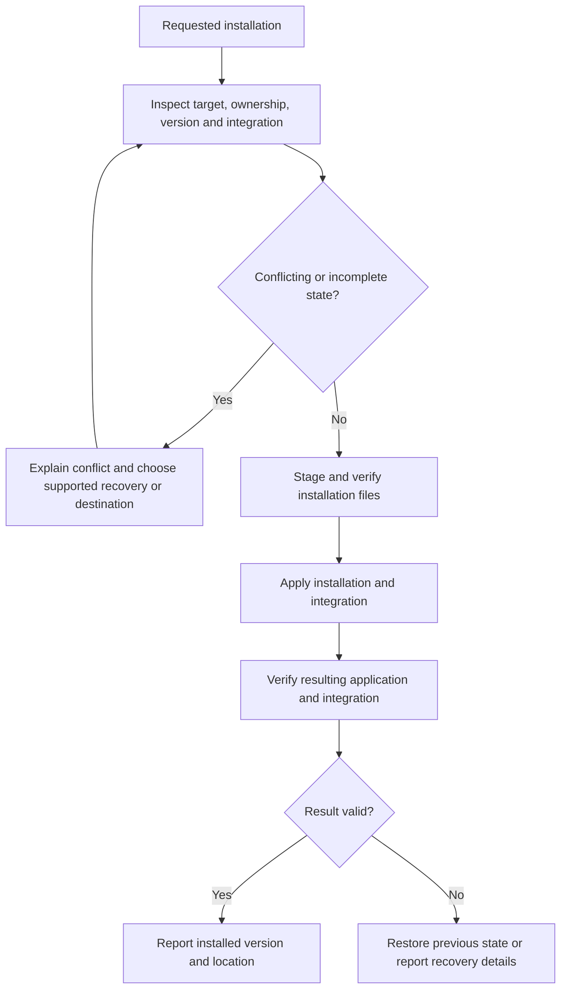

# Installation and distribution

## Distribution contract

**DI-01:** Releases MUST identify edition, application version, operating system, CPU architecture, package format and runtime prerequisites for every product artifact. Full and Lite artifacts from the same release must identify their shared application version. Brand-kit versions and optional tool versions are separate identities.

The three target operating systems are Windows, Linux and macOS. Specific OS versions and architectures require a published support matrix and corresponding evidence. A native executable for one platform is not an executable for all three. Cross-platform gallery preparation selects already-built release artifacts rather than requiring the sender to compile them.

## Full installation and Lite operation

| Property | Full installation | Lite distribution |
| --- | --- | --- |
| Primary use | Frequent use with installed integration | On-demand directory browsing and sharing |
| Placement | A platform-appropriate installation destination | A runnable package placed with or pointed at a gallery |
| Settings | Installed user state plus applicable gallery settings | Portable gallery settings and the declared session behavior |
| Dependencies | Installer provisions or verifies the release's requirements | Uses the supported host facilities declared for that artifact |
| Size reporting | Installer download, installed application and required runtime footprint | Download/extracted application footprint and any optional payloads |

**DI-02:** Lite MUST run without installing Full on a supported host. Its common browsing behavior MUST NOT depend on the sender's installed state. Lite need not include every runtime or tool shipped with Full. A missing prerequisite must produce an actionable dependency result; it must not silently substitute a different browser-based product or claim that installation succeeded.

MSI is allowed on Windows, alongside any justified EXE entry point. Full installation may be heavy. The documentation must report that footprint rather than using a small launcher size to characterize the complete installation. Exact package formats for each platform remain U-01.

## Installation lifecycle and collisions

**DI-03:** Installation MUST distinguish an owned installation from an unrelated file, command, shortcut or directory at the intended destination. It MUST NOT overwrite unrelated content as a side effect of resolving a name collision. Checks must cover the actual resolved destination, architecture, version and selected install scope. Repeated installation must have a defined outcome rather than adding duplicate integration entries.

An installation entry point may invoke the appropriate platform installer. The product need not reimplement standard installation machinery in each Lite binary. Elevation and per-user/per-machine scope follow the selected operation's requirements and must be explained before a privilege-dependent change.

## Updates, rollback and removal

**DI-04:** Updates MUST identify the existing and replacement versions, verify replacement artifacts, and preserve gallery media and user settings. State-format migration is governed by [configuration and state](configuration-and-state.md); rollback must not launch an older writer against an incompatible migrated store. Unsupported downgrade or recovery paths must be reported before destructive replacement.

An interrupted update must leave an identifiable prior installation, a verified replacement, or explicit recovery information. Reporting success requires verification of the installed result, not merely the completion of a download or a spawned installer process.

**DI-05:** Uninstallation MUST distinguish application-owned installation files from media, sidecars, portable galleries and user state. Removing Full must not remove shared galleries. Any removal of retained user data must be an explicit documented choice. Removing Lite from a gallery must not make the media depend on that deleted binary.

## Preparing binaries for sharing

Preparation offers recipient platform choices and identifies the version/architecture of each included artifact. **DI-06:** Added binaries MUST come from a verifiable release source and MUST NOT overwrite a user's existing gallery content without resolving the collision. An unavailable optional platform artifact must leave the gallery's media and already available launchers usable.

The archive must preserve any native bundle structure, executable permissions and required auxiliary files. The gallery root is outside an application's internal bundle or temporary mount directory. Renaming or relocating the outer shared directory must retain that relationship.

Packaging work must verify the actual extracted recipient experience. A ZIP containing an EXE, a macOS app bundle or a Linux launcher is not, by its extension alone, proof of support. Signing/notarization disposition, runtime discovery and install-free launch results belong in release evidence and the relevant support guidance.

## Open decisions

U-01 includes CPU architectures, minimum OS/runtime versions, Linux distribution/library baseline, signing arrangements, package formats, install scopes, destinations and optional dependency payloads. U-02 owns detailed edition capabilities. Resolve package choices using complete download/extracted sizes and native launch evidence; do not infer clean-machine independence from the size of the main executable. No measured package-size promise is established here.

See [verification and compatibility](verification-and-compatibility.md), the [index](index.md) and the [glossary](glossary.md).
