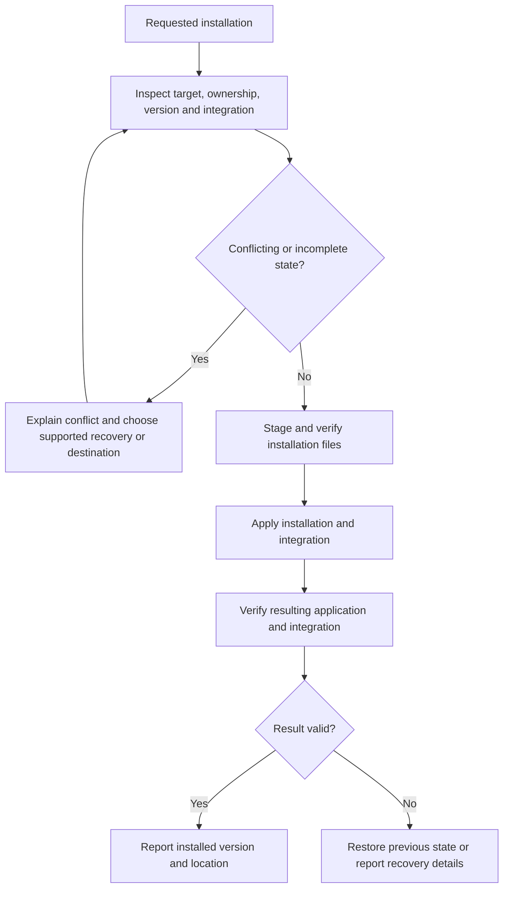

# Installation and distribution

## Distribution contract

**DI-01:** Releases MUST identify edition, application version, operating system, CPU architecture, package format and runtime prerequisites for every product artifact. Full and Lite artifacts from the same release must identify their shared application version. Brand-kit versions and optional tool versions are separate identities.

The three target operating systems are Windows, Linux and macOS. Specific OS versions and architectures require a published support matrix and corresponding evidence. A native executable for one platform is not an executable for all three. Cross-platform gallery preparation selects already-built release artifacts rather than requiring the sender to compile them.

## Full installation and Lite operation

| Property | Full installation | Lite distribution |
| --- | --- | --- |
| Primary use | Frequent use with installed integration | On-demand directory browsing and sharing |
| Placement | A platform-appropriate installation destination | A runnable package placed with or pointed at a gallery |
| Settings | Installed user state plus applicable gallery settings | Portable gallery settings and the declared session behavior |
| Dependencies | Installer provisions or verifies the release's requirements | Uses the supported host facilities declared for that artifact |
| Size reporting | Installer download, installed application and required runtime footprint | Download/extracted application footprint and any optional payloads |

**DI-02:** Lite MUST run without installing Full on a supported host. Its common browsing behavior MUST NOT depend on the sender's installed state. Lite need not include every runtime or tool shipped with Full. A missing prerequisite must produce an actionable dependency result; it must not silently substitute a different browser-based product or claim that installation succeeded.

MSI is allowed on Windows, alongside any justified EXE entry point. Full installation may be heavy. The documentation must report that footprint rather than using a small launcher size to characterize the complete installation. The initial package policy is defined below; proof archives do not implement installation.

## Installation lifecycle and collisions

**DI-03:** Installation MUST distinguish an owned installation from an unrelated file, command, shortcut or directory at the intended destination. It MUST NOT overwrite unrelated content as a side effect of resolving a name collision. Checks must cover the actual resolved destination, architecture, version and selected install scope. Repeated installation must have a defined outcome rather than adding duplicate integration entries.

An installation entry point may invoke the appropriate platform installer. The product need not reimplement standard installation machinery in each Lite binary. Elevation and per-user/per-machine scope follow the selected operation's requirements and must be explained before a privilege-dependent change.

## Updates, rollback and removal

**DI-04:** Updates MUST identify the existing and replacement versions, verify replacement artifacts, and preserve gallery media and user settings. State-format migration is governed by [configuration and state](configuration-and-state.md); rollback must not launch an older writer against an incompatible migrated store. Unsupported downgrade or recovery paths must be reported before destructive replacement.

An interrupted update must leave an identifiable prior installation, a verified replacement, or explicit recovery information. Reporting success requires verification of the installed result, not merely the completion of a download or a spawned installer process.

**DI-05:** Uninstallation MUST distinguish application-owned installation files from media, sidecars, portable galleries and user state. Removing Full must not remove shared galleries. Any removal of retained user data must be an explicit documented choice. Removing Lite from a gallery must not make the media depend on that deleted binary.

## Preparing binaries for sharing

Preparation offers recipient platform choices and identifies the version/architecture of each included artifact. **DI-06:** Added binaries MUST come from a verifiable release source and MUST NOT overwrite a user's existing gallery content without resolving the collision. An unavailable optional platform artifact must leave the gallery's media and already available launchers usable.

The archive must preserve any native bundle structure, executable permissions and required auxiliary files. The gallery root is outside an application's internal bundle or temporary mount directory. Renaming or relocating the outer shared directory must retain that relationship.

Packaging work must verify the actual extracted recipient experience. A ZIP containing an EXE, a macOS app bundle or a Linux launcher is not, by its extension alone, proof of support. Signing/notarization disposition, runtime discovery and install-free launch results belong in release evidence and the relevant support guidance.

## Initial platform and dependency matrix

The [canonical platform matrix](../../schemas/v0.0.0/platform-matrix.json) separates intended baselines, elected proof hosts and unqualified combinations. Both editions use the same native core, bundled interface, bundled SQLite and host webview. Recipients require no Node, npm, Python, Rust, FFmpeg executable or external database. Build tools are maintainer dependencies. Media decoding still depends on the host runtime and available codecs.

| Native target | Initial baseline and runtime | Elected proof and limits |
| --- | --- | --- |
| Windows x86_64 | Windows 10 22H2 or Windows 11, shared Evergreen WebView2, interactive desktop | Windows Server 2025 native CLI/archive proof and separate local Windows 11 rendered acceptance; other client versions require evidence |
| Linux x86_64 | Ubuntu 24.04 GNU ABI, glibc 2.39 build baseline, GTK3, WebKitGTK 4.1, libsoup3 and distribution media plugins | Ubuntu 24.04 native CLI/archive proof; X11/Wayland rendering and media remain separate |
| macOS aarch64 | macOS 15, OS-provided WKWebView, Apple Silicon | macOS 15 arm64 native CLI/app-bundle archive proof; desktop, quarantine and translocation remain separate |
| Windows aarch64 | Intended Windows 11 ARM64 and native Evergreen WebView2 | Retained target, unbuilt/unqualified |
| Linux aarch64 | Intended Ubuntu 24.04 ARM64 and native GTK/WebKitGTK stack | Retained target, unbuilt/unqualified |
| macOS x86_64 | Intended macOS 15 Intel and OS WKWebView | Retained target, unbuilt/unqualified |

Ubuntu 24.04 output does not establish Ubuntu 22.04, Debian 12 or older glibc compatibility. Those require an older ABI build and its own native proof. Emulated x64/ARM64 execution does not qualify the corresponding native architecture. The three operating systems remain product targets.

### Package and installation policy

| Platform | Full policy | Lite policy | Signing disposition |
| --- | --- | --- | --- |
| Windows | Per-user installation by default under the user's Programs location; machine scope under Program Files is explicit and may elevate; provision or verify shared Evergreen WebView2; MSI permitted | Extractable executable ZIP using the declared shared host runtime | Proof unsigned; final Authenticode disposition must be recorded |
| Linux | Debian package to system application locations through the package manager, with declared dependencies; other distributions need their own artifacts | Executable tar.gz using host libraries; AppImage requires separate packaging qualification | Proof archive unsigned; final package/repository signing must be recorded |
| macOS | App bundle in the elected user or system Applications directory, distributed by DMG | App bundle archive placed adjacent to the gallery, preserving bundle structure | Proof ad-hoc or unsigned as observed, unnotarized; final Developer ID, notarization and stapling remain packaging work |

Current exploratory archives contain normal Full/Lite executables, required bundle resources, licenses/notices, exact payload inventories and source/artifact identity. They are not published product packages or final installers. The install provider remains unavailable. Optional prepare previews and thumbnail generation are implemented; they never install tools or platform launchers. No optional external tool payload is shipped. Package collision, upgrade, rollback and removal behavior above remains mandatory for future installers.

### Prerequisites and footprint reporting

Windows GUI launch checks the installed WebView2 runtime and directs a missing-runtime user to install Microsoft's Evergreen Runtime. Linux GUI launch requires an accessible DISPLAY or WAYLAND_DISPLAY and the declared host libraries. Missing Linux dynamic libraries can fail before application code runs; the archive's prerequisite guide and loader diagnostic identify this boundary. macOS uses its OS webview and the selected minimum OS. CLI capabilities reports runtime version observations; it does not certify GUI or codec behavior. See [Tauri prerequisites](https://tauri.app/start/prerequisites/) and [Microsoft WebView2 distribution](https://learn.microsoft.com/en-us/microsoft-edge/webview2/concepts/distribution).

Proof receipts distinguish archive download bytes, extracted application bytes, executable bytes, installed runtime observations, optional tools and unavailable final-installer footprint. Unknown runtime size is null with a reason, never zero. A shared runtime directory's logical size is not a marginal install cost and excludes other system libraries. Hashes and sizes identify exact artifacts; they do not establish clean-machine independence, signing acceptance or a complete legal release audit.

## Open decisions

The initial U-01/U-02 matrix and package policy are defined here and in [edition capabilities](overview.md#editions). Final installer construction, signing credentials, clean-machine installation, broader OS/ABI targets and GUI/media qualification require their own concrete artifacts and evidence. No universal package-size promise is established.

See [verification and compatibility](verification-and-compatibility.md), the [index](index.md) and the [glossary](glossary.md).

## Native behavior qualification

Installation/package identity, extracted CLI behavior and rendered native media/accessibility are separate acceptance scopes. The [native campaign](verification-and-compatibility.md#native-media-and-accessibility-campaign) records observed format/orientation/color/audio and interaction results on each elected WebView. Virtual X11 is not Wayland evidence; native provider exposure is not untested screen-reader speech. No test framework or screen-reader payload becomes a recipient dependency.
