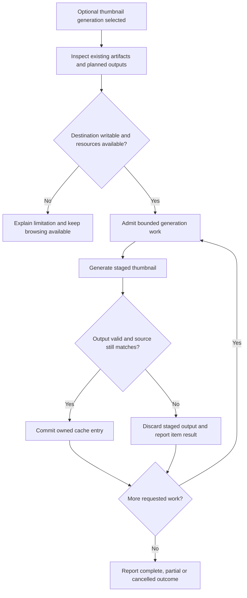

# Thumbnails and performance

## Performance purpose

The product targets practical collections containing thousands of images and videos. The goal is useful early results and responsive continued browsing without demanding a costly preparation step. Total collection size and simultaneously decoded/rendered media are different quantities.

**PF-01:** Browsing MUST work with no pre-generated thumbnails. The setup workflow MUST offer thumbnail generation as an optional performance improvement and explain its additional preparation/storage commitment. An absent or invalid cache must lead to an available original-media path or an attributable unsupported-media result.

## Optional generation lifecycle

**PF-02:** Generation MUST identify its destination and intended output types before writing, respect unrelated-file collisions, and expose useful progress. It must support cancellation without deleting source media or valid previously completed cache entries. Space, permissions and decoder failures must be attributable to the relevant job/item.

Image resizing, video frame selection, output formats, orientation, color handling and encoder versions remain U-09/U-04. Optional external media tools need their own version/provenance and distribution accounting. Generating an illustrative video thumbnail does not establish full playback support for that codec.

## Cache identity and freshness

**PF-03:** Cache entries MUST be associated with their source and generation parameters strongly enough to detect the changes covered by the declared cache policy. Replacing media at the same relative path, changing generation settings and moving the gallery must have defined outcomes. A missing, stale or partially written thumbnail must not be presented as a verified current result.

Thumbnail files are derived data. Deleting a cache must not remove required settings, original metadata or the only media listing. Portable caches must avoid required sender-specific absolute paths. Machine-local caches should be distinguishable from deliberate shared gallery output. Exact directories, entry records, fingerprints and eviction policy are U-09; compulsory full-media hashing before browsing is not established here.

## Adaptive loading

**PF-04:** The application MUST provide an automatic loading strategy that adapts work to observed responsiveness and the media involved. It must account for the difference between discovering an item, rendering its card, decoding an image, preparing a video frame and running a video decoder. Adding more items must not require admitting all of these activities simultaneously.

The selected page mounts at most 24, 48 or 96 cards, with 48 default. Gallery image source/decode and video metadata preparation share a finite queue. Automatic starts with four preparations, reduces to two then one under sustained pressure, and recovers one tier at a time. Conservative fixes two preparations; Standard fixes four. Corresponding near-viewport interest margins are 25, 10 and 0 percent. Visible waiting work is prioritized using current geometry at admission. Adaptation never changes pagination or deliberate presentation choices.

A session-local controller evaluates at most once per 250 ms. It retains at most 32 completion observations and 120 frame-callback gaps. With at least four completions, at least half taking over 500 ms or at least two failures comprising a quarter of the window signal pressure. Visible active work older than 1000 ms also signals pressure before completion. Frame pressure uses p95 over 50 ms after at least eight callback gaps; sparse gaps accumulate across windows until enough evidence exists. Two observed pressure windows reduce one tier; four healthy busy windows recover one tier. Idle windows cannot promote. These initial thresholds are tuning proposals based on a small native reference exercise, not universal throughput/frame-rate/memory guarantees.

Only visible demand samples animation callbacks. Hidden documents pause new admission and retire gallery sources; focused viewing removes gallery media/probes entirely. Resuming resets timing baselines, and frame gaps over 1000 ms are excluded. Cancellation and mode/session changes invalidate obsolete callbacks. A lower allowance lets already active preparations drain before replacements start. Settled images retain source-cleanup ownership until leaving interest/page/session; source removal does not certify immediate browser-internal decoder cancellation.

Preparation slots, retained decoded sources and native reads are different resources. There are at most 96 mounted card/source owners, one focused media element, one native discovery worker with one newest pending request, one sidecar inspection permit and 32 shared media-response permits per engine. Each response permit covers opening and streaming until its body is retired. Browser hardware-decoder and read-syscall counts are not exposed by these logical limits. Unsupported or damaged media remains attributable without blocking unrelated work.

**PF-05:** Explicit page size, valid location/selection, filters, sorting and healthy focused playback retain their identity when loading policy changes. The ordinary Loading strategy preference uses the common settings resolver; machine observations do not travel with a portable automatic choice. See [state ownership](configuration-and-state.md#current-user-preferences).

## Discovery and metadata work

Discovery runs only on opening a directory or explicit Refresh, with no idle scanning or snapshot polling. This is separate from demand-driven reads for visible cards and the focused asset. Discovery should prioritize useful incremental observations rather than waiting for every optional metadata read. Metadata parsing and field projection need bounded work for large JSON documents. Expensive optional facts should not block basic filenames/type information for the rest of the collection.

The application must reject stale results after gallery, filter or source-generation changes. Concurrency should be bounded at the shared backend resource boundary, not independently multiplied by each frontend component. Thousands of cards should not imply thousands of retained decoded originals or active file handles.

## Measurement contract

**PF-06:** Performance evidence MUST state dataset composition, file count, media sizes/codecs, storage medium, hardware, OS/runtime, cache state and operation measured. Cold opening, warm opening, scrolling, sorting/filtering, metadata inspection, playback seeking and optional generation need separate observations. Total process memory must include native and webview processes where the platform exposes them.

Download size, extracted application size, runtime dependencies, optional tools and thumbnail storage must be reported separately. A small native executable cannot substitute for the size of its full runnable distribution. No time, memory, frame-rate or package-size threshold is approved by the word lightweight.

## Measurement evidence and interpretation

The initial reference election uses twelve synthetic media candidates, including varied still shapes, one TIFF, one damaged JPEG and two short H.264 clips, plus a small nested JSON sidecar. Three fresh application/WebView profiles measure startup separately from warm requested reopen, scrolling, descending exact-size sorting, type filters, focused play/seek and metadata read/render. Fixture generation/readback warms unspecified OS caches: a fresh application profile does not establish OS-cache-cold evidence. Each run identifies hardware, OS/runtime, viewport/storage qualifications, exact binary/source, fixture bytes/codecs and source integrity.

Native-root and creation-checked descendant WebView processes report private bytes separately from working sets. Endpoint observations may miss transient peaks; summed working sets can double-count shared pages and private bytes do not equal physical RAM. Missing process coverage remains explicit. Animation callback gaps are responsiveness observations, not compositor FPS or proof of presented frames. Driver latency and in-renderer sub-timings are separate measurements.

Report development executable, shared installed runtime, profile/cache and fixture-preparation tooling independently. Product download/extracted package sizes are unavailable before packages exist; absent thumbnail tools/cache are not inferred from development tooling. Logical file bytes are distinct from allocated disk size or marginal runtime download.

## Open decisions

U-09 retains thumbnail tools/formats, frame selection, cache placement, identity and tool packaging. U-10 measurement representation, initial reference-fixture policy, finite adaptation and manual override are defined here. Performance targets remain evidence-dependent tuning proposals; native runtime/provider and practical-scale claims require their own measurements. Optional preparation and practical-scale operation remain product targets.

See [verification and compatibility](verification-and-compatibility.md), the [index](index.md) and the [glossary](glossary.md).
