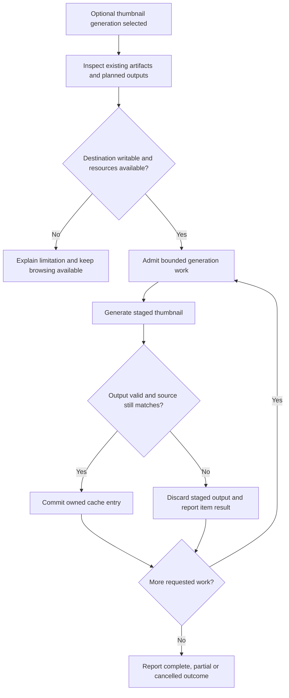

# Thumbnails and performance

## Performance purpose

The product targets practical collections containing thousands of images and videos. The goal is useful early results and responsive continued browsing without demanding a costly preparation step. Total collection size and simultaneously decoded/rendered media are different quantities.

**PF-01:** Browsing MUST work with no pre-generated thumbnails. The setup workflow MUST offer thumbnail generation as an optional performance improvement and explain its additional preparation/storage commitment. An absent or invalid cache must lead to an available original-media path or an attributable unsupported-media result.

## Optional generation lifecycle

**PF-02:** Generation MUST identify its destination and intended output types before writing, respect unrelated-file collisions, and expose useful progress. It must support cancellation without deleting source media or valid previously completed cache entries. Space, permissions and decoder failures must be attributable to the relevant job/item.

The delivered policy produces PNG within 320 × 320, preserving aspect ratio and alpha without cropping or enlarging. The built-in image 0.25.10 provider accepts JPEG, PNG, WebP, GIF, BMP and TIFF; it applies embedded orientation and uses the first decoded image. AVIF thumbnail generation is unavailable. Inputs are limited to 16384 pixels per dimension, 33554432 pixels and 128 MiB of decoded bytes; the decoder's 192 MiB allocation allowance is best effort, not a process-memory guarantee. Decoded RGB/RGBA is converted to 8-bit PNG without color metadata. ICC, CICP and HDR fidelity is unqualified.

Video generation uses a separately selected absolute FFmpeg executable with displayed SHA256, version and fd-input capability. The command line requires both the absolute path and expected hash. The application neither searches PATH nor downloads, bundles or installs that helper. The hash identifies selected bytes, not publisher authenticity or dynamic dependencies. A seekable native file grant supplies fd input; only that protocol is allowed for source reads. The first non-attached video stream supplies its first frame, with autorotation and sample-aspect-aware fitting. Audio, subtitles and data are omitted. One decoder/filter thread is elected. An illustrative frame does not certify playback support.

Helper output is limited to 4 MiB, stderr is continuously drained with at most 16 KiB retained internally, and the deadline is 30 seconds. Input pixels and single allocations are bounded; these are not total RSS guarantees. Cancellation or timeout requests termination and observes process exit and pipe closure. Unknown lifetime is reported explicitly and retains the worker reservation. Shutdown waits for observed completion; timeout alone never certifies stopped work.

## Cache identity and freshness

**PF-03:** Cache entries MUST be associated with their source and generation parameters strongly enough to detect the changes covered by the declared cache policy. Replacing media at the same relative path, changing generation settings and moving the gallery must have defined outcomes. A missing, stale or partially written thumbnail must not be presented as a verified current result.

Thumbnail files are derived data. The initial selection is a machine-local cache under the OS cache directory, product identifier and thumbnails-v1. Portable output is explicitly selected and uses .local-media-gallery-thumbnails-v1 directly inside the gallery. Preview hashes sources and inspects owned slots without creating directories, profile state or cache records. Its destination, source, provider, policy, collisions and storage upper bound bind the subsequent explicit start. A conflict requires a new preview.

Format 1 uses an exact relative source name, full source SHA256/byte length, canonical output policy, provider identity and validated PNG bytes/hash/dimensions in one bounded complete JSON envelope. Each entry is at most 6 MiB, containing at most 4 MiB of PNG. Unicode names use UTF-8 for cross-platform identity; otherwise native bytes are tagged Windows UTF-16LE or Unix bytes. Non-Unicode names cannot be assumed convertible across platforms. Sender absolute paths and file IDs are absent from portable records. Native file IDs separately detect session races.

Each source/content-policy key has 16 immutable no-clobber slots. Valid matching provider entries are reused during generation; compatible current cached entries remain consumable without an installed encoder. Source-content changes, including same-size replacements with preserved timestamps, require a fresh digest. Invalid, oversized, future, corrupt or incomplete entries are misses. Focused viewing and metadata retain original-media identity and content.

Generation stages and validates an envelope before commit, coordinates cooperative writers, then rechecks root, source, destination and cancellation authority. Hard-link publication is preferred. On filesystems without that operation, create-new publication writes a complete envelope into a reserved new name; interruption may leave an invalid miss. This is recoverable publication, not a universal atomic-filesystem guarantee. Pre/post observations cannot establish an atomic snapshot against an uncooperative in-place editor. Existing valid entries, originals, sidecars and unrelated files are never overwritten.

Completed entries are not automatically evicted. Explicit cleanup checks ownership and bounded per-file contents, removes only validated owned entries/staging and retains corrupt, unrecognized and future records. It never recursively erases a directory. Exhausted slots require inspecting the preserved destination and explicit owned cleanup or another selected cache.

One admitted preview/generation/cleanup worker publishes ordered progress and exact completed/reused/failed/skipped/remaining counts. Preview itself is asynchronous and cancellable. Optional visible-card validation has two shared native permits, a finite client queue and at most 96 retained interest owners. It is cancelled on retirement and runs alongside original rendering; opening a gallery never waits for source hashes. Thumbnail decode facts and errors remain separate from original media facts, with original fallback after cache failure.

## Adaptive loading

**PF-04:** The application MUST provide an automatic loading strategy that adapts work to observed responsiveness and the media involved. It must account for the difference between discovering an item, rendering its card, decoding an image, preparing a video frame and running a video decoder. Adding more items must not require admitting all of these activities simultaneously.

The selected page mounts at most 24, 48 or 96 cards, with 48 default. Gallery image source/decode and video metadata preparation share a finite queue. Automatic starts with four preparations, reduces to two then one under sustained pressure, and recovers one tier at a time. Conservative fixes two preparations; Standard fixes four. Corresponding near-viewport interest margins are 25, 10 and 0 percent. Visible waiting work is prioritized using current geometry at admission. Adaptation never changes pagination or deliberate presentation choices.

A session-local controller evaluates at most once per 250 ms. It retains at most 32 completion observations and 120 frame-callback gaps. With at least four completions, at least half taking over 500 ms or at least two failures comprising a quarter of the window signal pressure. Visible active work older than 1000 ms also signals pressure before completion. Frame pressure uses p95 over 50 ms after at least eight callback gaps; sparse gaps accumulate across windows until enough evidence exists. Two observed pressure windows reduce one tier; four healthy busy windows recover one tier. Idle windows cannot promote. These initial thresholds are tuning proposals based on a small native reference exercise, not universal throughput/frame-rate/memory guarantees.

Only visible demand samples animation callbacks. Hidden documents pause new admission and retire gallery sources; focused viewing removes gallery media/probes entirely. Resuming resets timing baselines, and frame gaps over 1000 ms are excluded. Cancellation and mode/session changes invalidate obsolete callbacks. A lower allowance lets already active preparations drain before replacements start. Settled images retain source-cleanup ownership until leaving interest/page/session; source removal does not certify immediate browser-internal decoder cancellation.

Preparation slots, retained decoded sources and native reads are different resources. There are at most 96 mounted card/source owners, one focused media element, one native discovery worker with one newest pending request, one sidecar inspection permit and 32 shared media-response permits per engine. Each response permit covers opening and streaming until its body is retired. Browser hardware-decoder and read-syscall counts are not exposed by these logical limits. Unsupported or damaged media remains attributable without blocking unrelated work.

**PF-05:** Explicit page size, valid location/selection, filters, sorting and healthy focused playback retain their identity when loading policy changes. The ordinary Loading strategy preference uses the common settings resolver; machine observations do not travel with a portable automatic choice. See [state ownership](configuration-and-state.md#current-user-preferences).

## Discovery and metadata work

Discovery runs only on opening a directory or explicit Refresh, with no idle scanning or snapshot polling. This is separate from demand-driven reads for visible cards and the focused asset. Discovery should prioritize useful incremental observations rather than waiting for every optional metadata read. Metadata parsing and field projection need bounded work for large JSON documents. Expensive optional facts should not block basic filenames/type information for the rest of the collection.

The application must reject stale results after gallery, filter or source-generation changes. Concurrency should be bounded at the shared backend resource boundary, not independently multiplied by each frontend component. Thousands of cards should not imply thousands of retained decoded originals or active file handles.

## Measurement contract

**PF-06:** Performance evidence MUST state dataset composition, file count, media sizes/codecs, storage medium, hardware, OS/runtime, cache state and operation measured. Cold opening, warm opening, scrolling, sorting/filtering, metadata inspection, playback seeking and optional generation need separate observations. Total process memory must include native and webview processes where the platform exposes them.

Download size, extracted application size, runtime dependencies, optional tools and thumbnail storage must be reported separately. A small native executable cannot substitute for the size of its full runnable distribution. No time, memory, frame-rate or package-size threshold is approved by the word lightweight.

## Measurement evidence and interpretation

The initial reference election uses twelve synthetic media candidates, including varied still shapes, one TIFF, one damaged JPEG and two short H.264 clips, plus a small nested JSON sidecar. Three fresh application/WebView profiles measure startup separately from warm requested reopen, scrolling, descending exact-size sorting, type filters, focused play/seek and metadata read/render. Fixture generation/readback warms unspecified OS caches: a fresh application profile does not establish OS-cache-cold evidence. Each run identifies hardware, OS/runtime, viewport/storage qualifications, exact binary/source, fixture bytes/codecs and source integrity.

Native-root and creation-checked descendant WebView processes report private bytes separately from working sets. Endpoint observations may miss transient peaks; summed working sets can double-count shared pages and private bytes do not equal physical RAM. Missing process coverage remains explicit. Animation callback gaps are responsiveness observations, not compositor FPS or proof of presented frames. Driver latency and in-renderer sub-timings are separate measurements.

Report development executable, shared installed runtime, profile/cache and fixture-preparation tooling independently. Product download/extracted package sizes are unavailable before packages exist; absent thumbnail tools/cache are not inferred from development tooling. Logical file bytes are distinct from allocated disk size or marginal runtime download.

## Open decisions

U-09 tools/formats, frame selection, cache placement, fingerprints and cleanup are defined above. No optional product helper payload is distributed. Maintainer-only native proof tools have separate pinned download/extracted/license receipts and are not recipient prerequisites. U-10 measurement representation, initial reference-fixture policy, finite adaptation and manual override are defined here. Performance targets remain evidence-dependent tuning proposals; native runtime/provider and practical-scale claims require their own measurements. Optional preparation and practical-scale operation remain product targets.

See [verification and compatibility](verification-and-compatibility.md), the [index](index.md) and the [glossary](glossary.md).

Cleanup streams bounded per-file checks, with one worker and cancellation between entries. Its total candidates and remaining count are null while the directory total is unknown; completed/retained/failed observations stay exact even after interruption. Successful enumeration records its examined total and zero remaining. This is independent of the original-media candidate count.

Once a cached card image is validated and decoded, its covered original card source and metadata probe retire. Thumbnail dimensions remain separate from original media facts. Focused viewing opens its independent original source; releasing a card source does not certify immediate reclamation of browser-internal decoder memory.

Explicit Refresh retires visible cache interests and revalidates full source content even when observed native size/timestamps and item revision are unchanged. An owned cache with only metadata and no output records is rejected without hashing original files.
