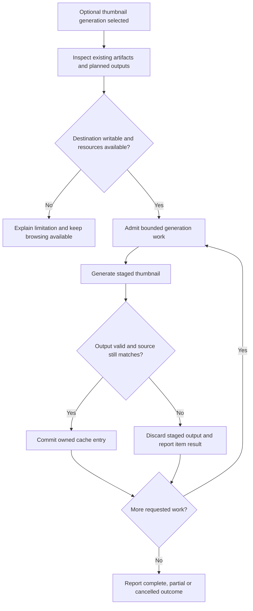

# Thumbnails and performance

## Performance purpose

The product targets practical collections containing thousands of images and videos. The goal is useful early results and responsive continued browsing without demanding a costly preparation step. Total collection size and simultaneously decoded/rendered media are different quantities.

**PF-01:** Browsing MUST work with no pre-generated thumbnails. The setup workflow MUST offer thumbnail generation as an optional performance improvement and explain its additional preparation/storage commitment. An absent or invalid cache must lead to an available original-media path or an attributable unsupported-media result.

## Optional generation lifecycle

**PF-02:** Generation MUST identify its destination and intended output types before writing, respect unrelated-file collisions, and expose useful progress. It must support cancellation without deleting source media or valid previously completed cache entries. Space, permissions and decoder failures must be attributable to the relevant job/item.

Image resizing, video frame selection, output formats, orientation, color handling and encoder versions remain U-09/U-04. Optional external media tools need their own version/provenance and distribution accounting. Generating an illustrative video thumbnail does not establish full playback support for that codec.

## Cache identity and freshness

**PF-03:** Cache entries MUST be associated with their source and generation parameters strongly enough to detect the changes covered by the declared cache policy. Replacing media at the same relative path, changing generation settings and moving the gallery must have defined outcomes. A missing, stale or partially written thumbnail must not be presented as a verified current result.

Thumbnail files are derived data. Deleting a cache must not remove required settings, original metadata or the only media listing. Portable caches must avoid required sender-specific absolute paths. Machine-local caches should be distinguishable from deliberate shared gallery output. Exact directories, entry records, fingerprints and eviction policy are U-09; compulsory full-media hashing before browsing is not established here.

## Adaptive loading

**PF-04:** The application MUST provide an automatic loading strategy that adapts work to observed responsiveness and the media involved. It must account for the difference between discovering an item, rendering its card, decoding an image, preparing a video frame and running a video decoder. Adding more items must not require admitting all of these activities simultaneously.

The current baseline applies structural bounds: the selected page mounts at most 24, 48 or 96 cards, with 48 the default. Image load/decode and video metadata work share at most four concurrent gallery admissions. Visible or nearby cards receive priority; unchanged item revisions reuse known facts. Page, session and focused-view transitions cancel obsolete work and unload sources. During focused viewing there are no background gallery media elements or metadata probes. These bounds do not establish a measured frame-rate or memory guarantee.

More extensive responsiveness-based calibration remains future work. Useful signals include visible area, decode/read latency, outstanding work, frame responsiveness and recent task failures. Optional platform memory/device hints may assist but must not be the only basis for a strategy that must work across different webviews. Work queues and active decoder counts require finite bounds.

A manual presentation/performance choice should remain available. **PF-05:** Adaptation MUST preserve the user's valid selection and browsing position and must not silently replace explicit settings with permanent device-specific values. Changing render overscan or prefetch work is distinct from unpredictably moving the user between pages. A portable automatic-mode choice should trigger fresh measurements on the recipient's machine.

## Discovery and metadata work

Discovery runs only on opening a directory or explicit Refresh, with no idle scanning or snapshot polling. This is separate from demand-driven reads for visible cards and the focused asset. Discovery should prioritize useful incremental observations rather than waiting for every optional metadata read. Metadata parsing and field projection need bounded work for large JSON documents. Expensive optional facts should not block basic filenames/type information for the rest of the collection.

The application must reject stale results after gallery, filter or source-generation changes. Concurrency should be bounded at the shared backend resource boundary, not independently multiplied by each frontend component. Thousands of cards should not imply thousands of retained decoded originals or active file handles.

## Measurement contract

**PF-06:** Performance evidence MUST state dataset composition, file count, media sizes/codecs, storage medium, hardware, OS/runtime, cache state and operation measured. Cold opening, warm opening, scrolling, sorting/filtering, metadata inspection, playback seeking and optional generation need separate observations. Total process memory must include native and webview processes where the platform exposes them.

Download size, extracted application size, runtime dependencies, optional tools and thumbnail storage must be reported separately. A small native executable cannot substitute for the size of its full runnable distribution. No time, memory, frame-rate or package-size threshold is approved by the word lightweight.

## Open decisions

U-09 owns thumbnail tools/formats, frame selection, cache placement, identity and tool packaging. U-10 owns benchmark fixtures, hardware, responsiveness/time/memory budgets and automatic adaptation thresholds. Resolve these through representative measurements before publishing numerical claims. Optional preparation and operation at the agreed practical scale remain required independently of those values.

See [verification and compatibility](verification-and-compatibility.md), the [index](index.md) and the [glossary](glossary.md).
