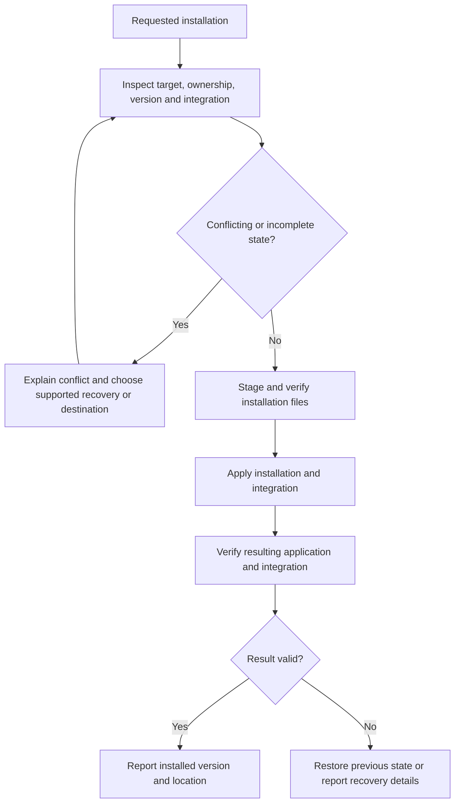

# Installation and distribution

## Distribution contract

**DI-01:** Releases MUST identify edition, application version, operating system, CPU architecture, package format and runtime prerequisites for every product artifact. Full and Lite artifacts from the same release must identify their shared application version. Brand-kit versions and optional tool versions are separate identities.

The three target operating systems are Windows, Linux and macOS. Specific OS versions and architectures require a published support matrix and corresponding evidence. A native executable for one platform is not an executable for all three. Cross-platform gallery preparation selects already-built release artifacts rather than requiring the sender to compile them.

## Full installation and Lite operation

| Property | Full installation | Lite distribution |
| --- | --- | --- |
| Primary use | Frequent use with installed integration | On-demand directory browsing and sharing |
| Placement | A platform-appropriate installation destination | A runnable package placed with or pointed at a gallery |
| Settings | Installed user state plus applicable gallery settings | Portable gallery settings and the declared session behavior |
| Dependencies | Installer provisions or verifies the release's requirements | Uses the supported host facilities declared for that artifact |
| Size reporting | Installer download, installed application and required runtime footprint | Download/extracted application footprint and any optional payloads |

**DI-02:** Lite MUST run without installing Full on a supported host. Its common browsing behavior MUST NOT depend on the sender's installed state. Lite need not include every runtime or tool shipped with Full. A missing prerequisite must produce an actionable dependency result; it must not silently substitute a different browser-based product or claim that installation succeeded.

MSI is allowed on Windows, alongside any justified EXE entry point. Full installation may be heavy. The documentation must report that footprint rather than using a small launcher size to characterize the complete installation. The initial package policy is defined below; proof archives do not implement installation.

## Installation lifecycle and collisions

**DI-03:** Installation MUST distinguish an owned installation from an unrelated file, command, shortcut or directory at the intended destination. It MUST NOT overwrite unrelated content as a side effect of resolving a name collision. Checks must cover the actual resolved destination, architecture, version and selected install scope. Repeated installation must have a defined outcome rather than adding duplicate integration entries.

An installation entry point may invoke the appropriate platform installer. The product need not reimplement standard installation machinery in each Lite binary. Elevation and per-user/per-machine scope follow the selected operation's requirements and must be explained before a privilege-dependent change.

## Updates, rollback and removal

**DI-04:** Updates MUST identify the existing and replacement versions, verify replacement artifacts, and preserve gallery media and user settings. State-format migration is governed by [configuration and state](configuration-and-state.md); rollback must not launch an older writer against an incompatible migrated store. Unsupported downgrade or recovery paths must be reported before destructive replacement.

An interrupted update must leave an identifiable prior installation, a verified replacement, or explicit recovery information. Reporting success requires verification of the installed result, not merely the completion of a download or a spawned installer process.

**DI-05:** Uninstallation MUST distinguish application-owned installation files from media, sidecars, portable galleries and user state. Removing Full must not remove shared galleries. Any removal of retained user data must be an explicit documented choice. Removing Lite from a gallery must not make the media depend on that deleted binary.

## Preparing binaries for sharing

Preparation offers recipient platform choices and identifies the version/architecture of each included artifact. **DI-06:** Added binaries MUST come from a verifiable release source and MUST NOT overwrite a user's existing gallery content without resolving the collision. An unavailable optional platform artifact must leave the gallery's media and already available launchers usable.

The archive must preserve any native bundle structure, executable permissions and required auxiliary files. The gallery root is outside an application's internal bundle or temporary mount directory. Renaming or relocating the outer shared directory must retain that relationship.

Packaging work must verify the actual extracted recipient experience. A ZIP containing an EXE, a macOS app bundle or a Linux launcher is not, by its extension alone, proof of support. The no-project-signing policy, actual host assessments, runtime discovery and install-free launch results belong in release evidence and the relevant support guidance.

## Initial platform and dependency matrix

The [canonical platform matrix](../../schemas/v0.1.0/platform-matrix.json) separates intended baselines, elected proof hosts and combinations not yet tested. Both editions use the same native core, bundled interface, bundled SQLite and host webview. Recipients require no Node, npm, Python, Rust, FFmpeg executable or external database. Build tools are maintainer dependencies. Media decoding still depends on the host runtime and available codecs.

| Native target | Initial baseline and runtime | Elected proof and limits |
| --- | --- | --- |
| Windows x86_64 | Windows 10 22H2 or Windows 11, shared Evergreen WebView2, interactive desktop | Windows Server2025 native CLI/archive and isolated rendered/media/AT election; other client/runtime versions require their own evidence |
| Linux x86_64 | Ubuntu 24.04 GNU ABI, glibc 2.39 build baseline, GTK3, WebKitGTK 4.1, libsoup3 and distribution media plugins | Ubuntu 24.04 native CLI/archive and isolated X11/Xvfb rendered/media/AT election; Wayland has not been tested |
| macOS aarch64 | macOS 15, OS-provided WKWebView, Apple Silicon | macOS15 arm64 native CLI/app-bundle and isolated WKWebView rendered/media/AX election; quarantine and translocation remain separate |
| Windows aarch64 | Intended Windows 11 ARM64 and native Evergreen WebView2 | Retained target, not yet built or tested |
| Linux aarch64 | Intended Ubuntu 24.04 ARM64 and native GTK/WebKitGTK stack | Retained target, not yet built or tested |
| macOS x86_64 | Intended macOS 15 Intel and OS WKWebView | Retained target, not yet built or tested |

Ubuntu 24.04 output does not establish Ubuntu 22.04, Debian 12 or older glibc compatibility. Those require an older ABI build and its own native proof. Emulated x64/ARM64 execution does not qualify the corresponding native architecture. The three operating systems remain product targets.

### Package and installation policy

| Platform | Full policy | Lite policy | Signing disposition |
| --- | --- | --- | --- |
| Windows | Per-user installation by default under the user's Programs location; machine scope under Program Files is explicit and may elevate; provision or verify shared Evergreen WebView2; MSI permitted | Extractable executable ZIP using the declared shared host runtime | Project signing is not performed by policy; report actual host assessments |
| Linux | Debian package to system application locations through the package manager, with declared dependencies; other distributions need their own artifacts | Executable tar.gz using host libraries; AppImage requires separate packaging qualification | Project package/repository signing is not performed by policy |
| macOS | App bundle in the elected user or system Applications directory, distributed by DMG | App bundle archive placed adjacent to the gallery, preserving bundle structure | Project signing, notarization and stapling are not performed by policy; ordinary compiler/linker loader metadata is preserved |

Exploratory native archives remain separate from Windows release-profile package candidates. The Windows Full candidate ZIP contains user and machine MSI packages, `setup.exe` for the current user and `setup-machine.exe` for explicitly elevated machine installation, the pinned Microsoft online WebView2 bootstrapper, identities and prerequisite guidance. Lite's ZIP places its ordinary executable at the extracted gallery root with notices and an exact payload manifest. Use the matching canonical release record to determine actual publication and download identity; a build candidate alone does not establish availability. The application's global install provider remains unavailable; these installation entrypoints are separate. Optional preparation never installs tools or platform launchers, and no FFmpeg payload is shipped.

### Windows candidate operations

1. Extract the complete Full candidate ZIP. Run `setup.exe` for the current user, or explicitly select `setup-machine.exe` for administrator scope. Default destinations are `%LOCALAPPDATA%\Programs\Local Media Gallery` and `%ProgramFiles%\Local Media Gallery` respectively. `--directory ABSOLUTE_PATH` selects an empty destination. Close running gallery windows first.
2. Setup verifies immutable MSI/vendor inputs and actual installation ownership before changing the application. It verifies shared WebView2 and provisions it through Microsoft's signed online bootstrapper when needed. Internet is required for provisioning. Success requires native runtime and installed payload/integration read-back. A Start menu shortcut and one scope-specific PATH segment expose the application; open a fresh terminal after installation.
3. Repeat the same candidate to verify the owned installation. A different candidate/version or foreign destination, command or integration is a conflict with recovery guidance. Cross-version migration and downgrade are separate operations and are not automatically attempted.
4. Keep the matching Full candidate for removal. `setup.exe --remove` or `setup-machine.exe --remove` uses Windows Installer to remove explicit owned files, shortcut, registry values and PATH segment. Modified ownership/integration blocks destructive removal. Media, sidecars, gallery settings, machine preferences/history, foreign extras and shared WebView2 remain independent and retained.
5. Extract Lite beside media and launch `local-media-gallery.exe`, or pass an explicit directory. The executable's parent is the in-place root, regardless of working directory. Move the complete payload and gallery together; select Refresh after media changes. Lite requires the declared host WebView2 runtime and never installs Full. Remove only its inventoried package files to leave media independently usable.

Candidate identities follow the [Windows payload schema](../../schemas/v0.1.0/windows-packages.schema.json). Standard MSI transactions handle copy, registration and rollback; project checks compare actual registered package/component destinations and file/integration ownership. Unsupported replacements never execute an arbitrary registry uninstaller. Failed/canceled operations report failure and the installer log location; a timed-out client does not prove the Windows Installer service has stopped.

Windows package qualification runs on an isolated Server2025 host and uses ordinary release artifacts, external native accessibility and actual pixels. Client OS versions, unsigned trust prompts and physically clean runtime provisioning have not been tested. A controlled process-local native-loader failure exercises actionable missing-runtime handling without pretending that the host runtime was physically absent. Bootstrapper input identity is pinned; Evergreen's installed runtime version and actual scope are observations. The updater can select a different scope when a shared machine updater already exists.

### macOS candidate operations

The elected candidate target is macOS15 on Apple Silicon. Full is a read-only DMG containing the ordinary release app, a native `lmg-setup` lifecycle helper, candidate identity and prerequisites. Lite is a ZIP containing the ordinary release app, notices, candidate metadata and the update/recovery helper. Only containers listed by the matching canonical release record are published product downloads. Bundled notices, icons and assets stay inside each app during installation and relocation.

1. Mount Full and inspect its prerequisites. From the mounted directory run `./lmg-setup install --scope user`. Defaults are `~/Applications/Local Media Gallery Full.app` and `~/.local/bin/local-media-gallery`. Add that command directory to your own PATH if needed; setup does not edit shell profiles.
2. System scope is explicit: `lmg-setup install --scope system` requires prior administrator elevation and defaults to `/Applications/Local Media Gallery Full.app` and `/usr/local/bin/local-media-gallery`. Setup never elevates itself. `--directory ABSOLUTE_APP_PATH` and `--command-directory ABSOLUTE_DIRECTORY` elect custom destinations.
3. Setup verifies host architecture/OS/WKWebView, exact inventoried candidate bytes, physical destination and command ownership. It rejects unrelated content and visible command collisions. Repeating the exact unchanged candidate verifies the existing installation without adding integration. Use the explicit update/recovery operation below for another compatible candidate; install continues to verify matching-candidate repetition and reject changed ownership.
4. Launch the installed app and choose a gallery, or run its command with an explicit directory. Full launched from its DMG still requires a gallery choice. The gallery stays outside bundle internals and temporary package mounts.
5. Keep the matching DMG/helper for removal. Close gallery windows, then run `lmg-setup remove` with the same scope and custom destinations. Removal deletes unchanged owned app files and the exact command symlink, retains altered/foreign files and reports them, and retains external galleries, media, sidecars, settings/history and OS WebKit.
6. Extract Lite with Archive Utility or `ditto -x -k ARCHIVE DIRECTORY`, preserving its complete bundle and executable permissions. Place the app beside gallery media, or supply an explicit root. Move the outer app/gallery/settings directory together. Use Refresh after adding/removing media. Lite needs neither Full nor developer tools nor a chosen browser.

Complete file/hash/mode inventories and physical ownership determine candidate integrity. The project performs no artifact signing, notarization or stapling and requires no related credentials. Ordinary compiler/linker loader metadata is preserved; it does not assert publisher identity. Quarantined downloads may be blocked by Gatekeeper. Packaging evidence reports native assessment separately from functional unquarantined launch. The product and installer never clear quarantine automatically. Recognized AppTranslocation placement cannot supply a reliable implicit gallery, so Lite requests an explicit directory. macOS provides no supported complete original-location recovery; ordinary external-volume galleries remain valid.

Download, extracted-container and installed-application logical bytes are separate measurements. OS-provided WKWebView is shared with macOS; its attributable application runtime footprint is unavailable with that reason, not zero. No optional FFmpeg payload is included.

### Linux candidate operations

The elected target is Ubuntu 24.04 x86_64, glibc2.39 and the declared GTK3/WebKitGTK4.1/libsoup3/GStreamer runtime. Full is an unsigned system Debian package; Lite is an executable tar.gz. Both contain ordinary release-profile binaries, complete notices and exact source/payload identities. Actual published packages are selected from the matching canonical release record. A .deb filename does not establish support for another distribution or older ABI; Wayland and other architectures require separate evidence.

1. Install Full with the host package manager, for example `sudo apt install --reinstall ./local-media-gallery-0.1.0-full-x86_64-linux-candidate.deb`. APT resolves the derived shared-library dependencies and declared media plugins. Administrator authorization is explicit; the application never elevates or invokes APT recursively. Installation owns `/usr/lib/local-media-gallery`, `/usr/bin/local-media-gallery`, one desktop entry and exact governed hicolor icons. No default file association or shell-profile change is made.
2. Debian maintainer guards verify the exact candidate, registered ownership, hashes, modes and physical parents before replacing/removing files. Existing foreign destinations, visible commands, symlinks, diversions or changed owned files produce conflict guidance. The documented `--reinstall` invocation runs the guards even for an equal Debian version; plain APT already-installed output does not verify payload bytes. Reinstalling the identical unchanged candidate verifies it. APT/dpkg also permits a distinct candidate after its old guard validates installed bytes and its new guard validates incoming path ownership. Use the explicit retained-input workflow below for durable recovery and rollback. Package-manager interruption/error does not prove rollback beyond the observed state.
3. Launch Full from its desktop entry or command with an explicit gallery. Without a directory, Full opens folder selection. The gallery remains outside package internals. Finite CLI commands remain usable without a display; a GUI request requires a nonempty display environment and the declared native runtime.
4. Close the gallery, then use `sudo apt remove local-media-gallery`. `sudo apt purge local-media-gallery` also removes remaining package-manager metadata. Guards refuse destructive removal of changed/missing/redirected owned files; restore the matching files or inspect explicit recovery before retrying. Normal removal retains unrelated extras, external galleries, media, sidecars, portable settings and recipient preferences/history. It never runs dependency autoremove or deletes home-directory user data. A retained foreign application-directory extra can block a fresh reinstall until its destination is resolved.
5. Extract Lite with `tar -xzf ARCHIVE -C GALLERY`, retaining executable permissions and all notices/metadata. Launch `./local-media-gallery` beside media, or pass an explicit directory. The shell entrypoint and ordinary `local-media-gallery.bin` stay adjacent at the external root. An unrelated working directory does not change the implicit root; explicit root wins. Move the complete package/gallery/settings together and use Refresh after media changes. Remove only inventoried Lite files to leave media independently usable.
6. The entrypoint checks target architecture and actual GNU loader closure before exec. Other host combinations have not been tested even when their libraries resolve. Missing libraries produce actionable `prerequisite_unavailable` diagnostics on stderr with exit2, including native loader details. Native operation JSON/status codes apply after exec. Lite uses its declared host runtime; it does not install Full or require Node, Python, Rust, an FFmpeg executable or a chosen browser.

The [Linux payload schema](../../schemas/v0.1.0/linux-packages.schema.json) binds version/edition/target, release profile, exact files/modes and source identity. Container inventories separately hash candidate metadata without a recursive self hash. Full dependencies are derived from the actual ELF with `dpkg-shlibdeps`, supplemented by dynamically loaded media-plugin requirements. Product entrypoints require only declared host facilities; package builders and native observers are maintainer tools.

Qualification performs actual APT/dpkg lifecycle operations on a prepared isolated Ubuntu host, verifies installed dependencies and retains them through removal. It does not claim stripped clean-machine provisioning. A copied ordinary ELF with an injected absent library tests actual loader diagnostics without removing shared system libraries. Ordinary package AT-SPI/X11 snapshots and process-attributed output PCM remain distinct from the instrumented core media/clock/seek campaign. Project package/repository signing is not performed by policy. Actual host assessments and complete attributable shared-runtime bytes are reported separately; application/container measurements and cryptographic artifact identities remain separate.

## Explicit candidate updates and recovery

Update operates on explicitly supplied, verified candidate bytes. A candidate identifies its immutable contents independently of publication. This workflow does not discover a release, download an automatic update or create a background service. Close gallery windows first and run the companion from the separate replacement package. Retain the original complete candidate and select the actual recipient settings/history/gallery operands, including when running with administrator privileges. An elevated account's HOME does not identify every recipient profile.

Windows and Linux companions use this interface (absolute paths replace the operands):

~~~text
lmg-update update --from OLD.update.json --to NEW.update.json --directory INSTALL_ROOT --source NEW_PAYLOAD_ROOT --transaction TRANSACTION_ROOT --state-settings SETTINGS_FILE --state-history HISTORY_DATABASE --state-portable GALLERY_DIRECTORY
lmg-update status --transaction TRANSACTION_ROOT
lmg-update recover --transaction TRANSACTION_ROOT
lmg-update rollback --transaction TRANSACTION_ROOT
~~~

On Windows the executable is lmg-update.exe. Full selects the matching user or machine MSI descriptor and retains both complete MSIs. Lite selects each extracted package's update.json and its adjacent files. Full replacement/removal/restore uses Windows Installer, including its native integration checks. The companion does not copy or delete MSI-owned application files itself. Stable component identities and a changed PackageCode distinguish owned package generations even at the same software version. Matching actual same-version component/file/feature layouts use native recaching reinstall. Proven native feature groups keep unchanged owned notices in place and repair changed or missing owned groups; every file and integration is still verified. Unknown legacy feature layouts retain complete native reinstall, while changed component layouts or legacy packages use verified native removal/install. A legacy MSI lacking the recovery protocol cannot restore over retained foreign installation content; that combination is refused before staging instead of removing the current installation.

Linux Full requires prior root elevation and uses INSTALL_ROOT /, the supplied .deb sidecar descriptors and both complete .deb inputs. It extracts and verifies retained archives, then uses native dpkg unpack/configure transactions. Dependencies must already be ready through the declared APT prerequisite workflow. Lite uses its extracted update.json and payload root without installing Full. --source identifies the replacement payload for direct Lite switching; native Full adapters verify extracted retained installers. Do not substitute a bare executable, an internal Windows Installer cache entry or an incomplete archive for the original package.

macOS uses the replacement candidate's bound helper:

~~~text
./lmg-setup update --scope user --directory ABSOLUTE_APP --command-directory ABSOLUTE_BIN --transaction TRANSACTION_ROOT --state-settings SETTINGS_FILE --state-history HISTORY_DATABASE --state-portable GALLERY_DIRECTORY
./lmg-setup update --scope user --directory ABSOLUTE_LITE_APP --prior OLD_CANDIDATE_JSON --transaction TRANSACTION_ROOT --state-settings SETTINGS_FILE --state-history HISTORY_DATABASE --state-portable GALLERY_DIRECTORY
./lmg-setup status --transaction TRANSACTION_ROOT
./lmg-setup recover --transaction TRANSACTION_ROOT
./lmg-setup rollback --transaction TRANSACTION_ROOT
~~~

The second form is Lite: --prior identifies its matching retained prior candidate.json and no command integration is created. Full user scope retains its actual installation receipt and command link; system scope uses --scope system with prior administrator elevation and explicit recipient state. Keep the matching candidate/helper for ordinary removal. Recovery reads its retained scope and destinations instead of deriving a different account's defaults.

The transaction directory must be new, physical, outside owned installation content and the adjacent gallery, with an existing parent. Use recipient-owned private storage for user/Lite operations and root-owned storage for system operations. Prepared state retains complete verified old/new bytes. Applying state records intent before switching; direct replacement moves only inventoried application entries and preserves displaced bytes until verified. Native Debian unpack is an explicit incomplete boundary. Activated state remains provisional until inventory, ordinary executable identity and native integration are verified. Committed and Restored are verified terminal outcomes. The journal binds immutable candidate/destination/state identity separately from observed phase, and recovery reconciles actual old/new/missing files after a mutation that preceded the next journal write.

A successful update returns status complete; recovery of an already selected exact candidate returns already-current; explicit compatible rollback returns restored. Read-only status reports selected-present or incomplete and does not certify native completion. Conflicts return nonzero with the retained transaction path and diagnostic. A client timeout is incomplete: it does not prove its process or installer service stopped. An independent headless supervisor retains its native lease, waits for the actual native client and writes a terminal receipt even if the coordinating CLI ends. Recovery refuses while that supervisor is active or its launch/terminal state is indeterminate. Inspect retained logs/registration before retrying an unknown operation. Changed live/retained bytes, foreign registration or command paths, active application use, another destination operation, wrong edition/target and incompatible selected state block further destructive changes. Never force a retry by deleting locks, package registration or unknown files.

prepare stages a Windows/Linux transaction without activation; macOS calls this prepare-update with the same update operands. --events 1 emits newline-delimited JSON phase observations followed by the final result. These expose durable maintenance boundaries; a phase event alone is not a success receipt. Filesystem flushes support process-interruption recovery without asserting device-power-loss guarantees.

No durable-format migration is elected here. Existing settings/portable format1 and the owned history schema remain unchanged. The selected old and replacement ordinary writers inspect the supplied state read-only before activation. Unsupported future, foreign, corrupt or unreadable stores refuse activation with their bytes retained. Missing state is observed without initialization. Other profiles remain untouched and their ordinary writers retain their own compatibility checks. Rollback uses the retained old writer's probe. A baseline0.1.0 writer predating that command can use the other supplied0.1.0 writer to validate the unchanged format1/owned-history contract; both versions and native identities must agree. Other unsupported probes refuse activation. Software version ordering alone does not establish write compatibility.

Media, sidecars, gallery settings, preferences/history, foreign extras and shared runtimes remain independent. Completed transactions retain prior inputs for rollback; application uninstall does not erase those records or recipient data. Preserve incomplete/failed transactions until the observed conflict is resolved. See the [versioned update contract](../../schemas/v0.1.0/recipient-update.schema.json) for candidate, result and compatibility JSON structures.

### Prerequisites and footprint reporting

Windows GUI launch checks the installed WebView2 runtime and directs a missing-runtime user to install Microsoft's Evergreen Runtime. Linux GUI launch requires an accessible DISPLAY or WAYLAND_DISPLAY and the declared host libraries. Missing Linux dynamic libraries can fail before application code runs; the archive's prerequisite guide and loader diagnostic identify this boundary. macOS uses its OS webview and the selected minimum OS. CLI capabilities reports runtime version observations; it does not certify GUI or codec behavior. See [Tauri prerequisites](https://tauri.app/start/prerequisites/) and [Microsoft WebView2 distribution](https://learn.microsoft.com/en-us/microsoft-edge/webview2/concepts/distribution).

Proof receipts distinguish archive download bytes, extracted application bytes, executable bytes, installed runtime observations, optional tools and unavailable final-installer footprint. Unknown runtime size is null with a reason, never zero. A shared runtime directory's logical size is not a marginal install cost and excludes other system libraries. Hashes and sizes identify exact artifacts; they do not establish clean-machine independence, signing acceptance or a complete legal release audit.

## Open decisions

The initial U-01/U-02 matrix and package policy are defined here and in [edition capabilities](overview.md#editions). Windows, macOS and Linux packages implement the installation/removal paths above. Physically clean provisioning, additional native OS/ABI combinations, host trust assessments and actual release publication retain separate evidence. Signing is not a future prerequisite or planned project action. No universal package-size promise is established.

See [verification and compatibility](verification-and-compatibility.md), the [index](index.md) and the [glossary](glossary.md).

## Native behavior qualification

Installation/package identity, extracted CLI behavior and rendered native media/accessibility are separate acceptance scopes. The [native campaign](verification-and-compatibility.md#native-media-and-accessibility-campaign) records observed format/orientation/color/audio and interaction results on each elected WebView. Virtual X11 is not Wayland evidence; native provider exposure is not untested screen-reader speech. No test framework or screen-reader payload becomes a recipient dependency.

Windows user and Lite recovery storage defaults to `%USERPROFILE%\.local-media-gallery-updates`; machine storage defaults to `%ProgramData%\LocalMediaGalleryUpdates` and requires elevation. Recovery directories and files receive explicit private ACLs at creation. Existing untrusted storage is refused without changing its permissions or ownership. Place custom transaction directories under a trusted physical parent. Direct-file updates keep temporary displaced owned entries beside each live file, so retained transaction storage may be on a different drive. Unknown displaced bytes are retained as a conflict.

## Verified release assembly and publication

The release pipeline assembles the six elected ordinary Full/Lite package rows from retained successful native qualification. It verifies the original source revision/digest, numeric software version, complete inventories, modes, native behavior, dependency notices and archive bytes before staging a GitHub Release. Runtime-proof, replacement and negative-test packages are excluded from product downloads. Linux Full additionally publishes its matching external update descriptor; embedded updater material stays within the unchanged accepted archives.

The [canonical release contract](../../schemas/v0.1.0/release-record.schema.json) distinguishes candidate, staged and published records. It binds package names, edition/OS/architecture, prerequisites, optional tools, byte counts, SHA-256 hashes, canonical download URLs, eight qualification scopes and documentation/schema/review identity. A candidate identifier hashes immutable content; later service observations and documentation receipts do not change it. Canonical JSON refuses unknown fields, duplicate members and ambiguous identities. Product versions are canonical numeric triplets. The elected Windows installer also requires major/minor components at most255 and the patch component at most65535; prerelease/build suffixes are not supported by this package contract.

Production execution uses the manual Verified product release workflow on main. It revalidates the elected successful Qualification push-to-main run, required jobs, source ancestry, GitHub artifact digests and retained release-assembly evidence before credentialed writes. It independently reassembles the same native bytes. CI assembly retains the elected canonical predecessor and uses it to distinguish an ordinary vocabulary review from a major glossary refresh. Manual execution must use that same predecessor. Workflow inputs select the qualification run, version, expected previous published version and short highlights, including applicable breaking changes and migration guidance. Notes end with the master changelog link. A zero-version specification baseline and controlled service fixtures cannot authorize product publication.

Publication first creates an attributable draft and uploads exact accepted bytes. Existing identical assets are independently downloaded and compared; foreign or changed assets refuse without overwrite. Empty failed-upload starter assets are removable only when a retained upload attempt attributes their identity. This recovery also applies to a failed canonical release.json upload after publication. A lost create/upload/publish acknowledgement is reconciled by observing the service before another mutation. Actual tags, including annotated tags, must resolve to the elected source. Publishing initially leaves GitHub latest unchanged.

Complete candidate documentation qualification gates product publication. Actual published artifact readback and a separately qualified publication projection then gate canonical release.json upload/readback and compared latest promotion. A valid previously written canonical record is retained on retry when its immutable candidate and observed publication agree. Conflicting previous selection, remote edits or mismatched bytes refuse promotion. GitHub has no release-pointer compare-and-swap; serialized workflows and immediate before/after observations detect conflicts without claiming a service-wide transaction. Inspect retained execution records and remote state after an incomplete operation; preserve all accepted native inputs when resuming. The optional prior execution run input restores a matching upload journal only after verifying its main-branch manual workflow origin and GitHub artifact digest. Unattributed starters remain conflicts. Binaries are delivered through Releases, never the Pages tree.

Package metadata describes immutable build provenance. Publication authority comes from the observed canonical record, rather than rewriting accepted package bytes. No product signing, notarization or stapling is performed.
