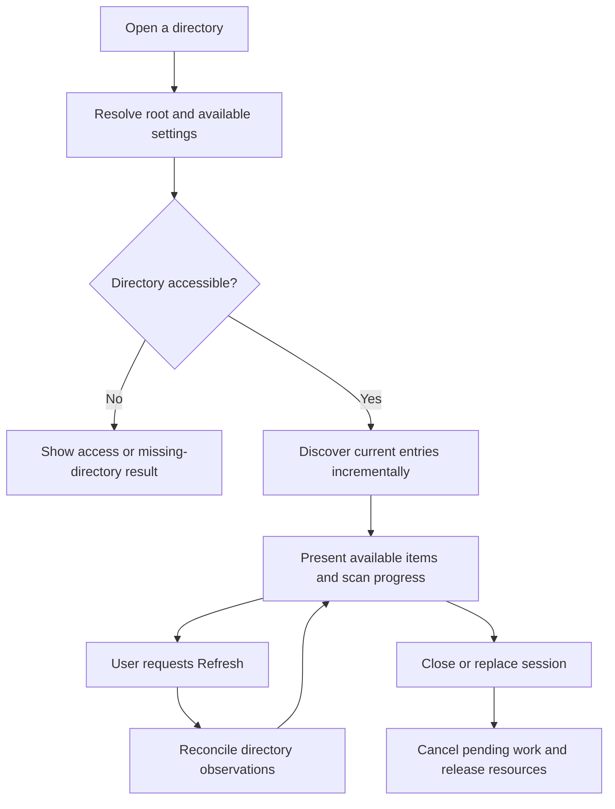

# Gallery lifecycle

## Root selection and identity

A gallery root is the directory selected for one browsing session. An installed command can receive an explicit directory, and the application can offer a native directory chooser. A Lite launcher placed with media must be able to resolve the containing gallery without relying on the sender's machine or the shell's current working directory.

**GL-01:** Root resolution MUST preserve native path semantics and distinguish the gallery location from application internals. A launcher inside a macOS bundle or mounted Linux package must resolve the intended outer gallery location. Explicit selection must take precedence over accidental process working-directory changes. The launch precedence is defined below.

An explicit directory always wins and is made absolute using native platform semantics against the invoking working directory. This preserves Windows drive-relative and rooted paths. Without one, Full requests selection; plain Lite uses its executable's containing directory. A macOS Lite executable inside an app bundle uses the parent of the outer .app, not Contents/MacOS. For AppImage placement, APPIMAGE must identify the original absolute package and APPDIR its absolute mount containing the executable; the original must be a regular file outside that mount. Missing or inconsistent context returns placement_unavailable rather than opening a temporary mount. Explicit root selection remains available. Recognized AppTranslocation placement returns placement_unavailable and requires an explicit gallery; this does not claim complete translocation detection or original-location recovery. External-volume galleries remain valid. Actual AppImage packaging and translocated GUI behavior need separate qualification.

Portable item relationships must be relative to the selected root where appropriate. Absolute paths may be used for current native access and installed remembered-location lookup, but must not become the required portable identity of every file. Display names, relative paths and machine-local file identity serve different purposes; do not collapse them into a single normalized string.

## Opening and discovery

**GL-02:** Opening MUST discover current media without requiring a previously prepared manifest, a thumbnail cache or a remembered-location record. Discovery SHOULD present available results incrementally. Initial discovery must expose whether its result is complete, partial or failed. Empty results must retain enough context to distinguish an empty scope from unreadable entries and active filtering.

An inaccessible child entry must be attributable without discarding successfully discovered siblings. The gallery must tolerate files disappearing, becoming unreadable or being replaced between enumeration and opening. Discovery publishes available observations and counts incrementally. Cancel retains useful observations and explicitly marks the result cancelled; it does not close the folder. The Cancel control remains available in the focused viewer as well as the gallery. A blocked OS call may finish later, but retired work cannot admit another entry or commit results. The next valid observation governs whether an item can be loaded. In-progress copies must not be reported as permanently corrupt solely because the first read was incomplete.

The current local browsing scope is direct regular-file image/video candidates, excluding subdirectories, linked descendants, dot-prefixed entries and Windows hidden/system/reparse entries. Recognized extensions nominate candidates; runtime decoding determines display/playback support. Names remain display data, with opaque native item identity. Discovery runs only when opening a directory or explicitly selecting **Refresh**. There are no background watchers, periodic directory scans or collection-snapshot polling. File/media access requested for a visible card or focused asset can still occur without a directory scan. File opens probe readability without decoding every original. View preferences persist in the user configuration file; current media facts are cached within the session.

**GL-03:** Directory traversal MUST terminate under the selected traversal policy and MUST NOT repeatedly follow a cycle. Recursion, external symlink traversal, nested galleries and mount boundaries require the explicit policy under U-03. An implementation must not accidentally decide those policies through the defaults of a filesystem library.

## Maintaining a current view

**GL-04:** Additions, removals and relevant file changes MUST be discoverable without manual manifest regeneration. Opening a directory and user-initiated **Refresh** MUST reconcile current directory observations. An open gallery MUST NOT scan automatically in the background. Its displayed collection remains the last requested discovery result until the user refreshes or reopens it.

Refresh must converge even if there is no previous cache or the gallery moved. Refresh requests reserve an operation identity and run through a single worker; a newer request supersedes older requested work without overlapping enumeration. Progress and completion apply only to the current session and operation. Completion indicators must distinguish initial discovery from a later refresh and describe partial or failed results. A requested media read can fail if a file changed after discovery; show the item failure and offer Refresh without silently starting a scan.

Automatic refresh remains a possible future advanced setting and must default off if introduced. It is not an available setting in the current interface.

Only complete enumeration may remove prior items that were not observed. Partial, cancelled, failed and unavailable scans retain those items with a visible not-yet-rechecked indication. An iterator failure after accessible entries is partial; inability to access or validate the root is unavailable; internal operation failure is failed. A genuinely empty complete scope and a filter with no matches remain distinct. Recovery requires explicit Refresh/retry or reopen.

Changes invalidate affected derived data and sidecar associations. The application preserves the selected item or prior first-visible page anchor after sorting/filtering the whole current collection. Newly arriving earlier items may change the page number while the anchor remains visible. If a complete result removes an anchor, the nearest surviving old neighbor is selected for page location (earlier neighbor wins ties), otherwise the page clamps to a valid/empty view with an explanation. Manual sort/filter/page changes choose a new anchor deliberately. The application should preserve selection and browsing position when the selected item still exists. When it disappears, the interface explains the change and chooses a documented neighboring or empty state rather than retaining a playable-looking dead entry.

## Optional preparation

Preparation is a deliberate operation. Prepare gallery independently elects current portable presentation, portable thumbnails and Windows x86_64, Linux x86_64 or macOS Apple Silicon recipient launchers. Thumbnails and validated cache cleanup also remain available through their existing controls and finite commands. Recipient launchers are acquired only from the verified canonical published Lite release. **GL-05:** The user MUST be able to decline thumbnail generation and continue browsing. Preparation must explain which files it intends to add, identify collisions, expose progress and support cancellation where meaningful.

Preparing a gallery does not transfer ownership of its originals to the application. Added artifacts must remain distinguishable from media and arbitrary user sidecars. A partly completed preparation must not prevent fresh discovery. Rerunning preparation should inspect existing owned outputs and avoid duplicating them or replacing unrelated files.

## Relocation, sharing and unavailable roots

**GL-06:** Renaming or moving the containing gallery directory MUST NOT require rebuilding a media manifest. Shared configuration and sidecar associations must be evaluated against the recipient's actual root. Missing caches can be rebuilt or bypassed. The recipient's application does not require access to the sender's per-user state.

For example, a synthetic gallery containing `harbor.jpg`, `harbor.jpg_meta.json`, `clip.mp4` and optional settings can be extracted under a different parent directory and drive. Discovery should locate the current files. After adding `portrait.png` or removing `clip.mp4`, selecting Refresh updates the available entries without running a preparation command.

On Windows, the current capability-relative access implementation holds the selected directory against rename/removal while open. Use **Close folder** or close the application before moving it. Reopening the new location discovers the current contents and retires former-session resource grants without a manifest.

Temporary loss of a removable drive or network location is not proof that the user's settings should be deleted. A session should show the unavailable root and allow a supported recovery path. Generic OS-mounted removable and network paths use the same best-effort requested discovery and explicit recovery path. Physical disconnect/reconnect, network outage, provider identity behavior and native Linux/macOS operation require separate qualification; local Windows and deterministic simulated failures do not establish those claims. Ordinary root relocation remains required.

## Open decisions

The initial U-03 policy is direct regular-file candidates, excluding descendant links/reparse points, hidden/system entries and directories. Recursion, nested galleries, directory links/cycles and child mounts are not entered. An explicitly selected root is canonicalized and may resolve an alias or root link; hard links remain ordinary direct files. All subsequent data access uses its held grant. A current pathname identity mismatch reports unavailable and requires explicit reopen rather than retargeting that grant. Identity detection depends on the filesystem/provider, including the documented limitations of native file identifiers.

Windows local path qualification covers spaces, Unicode, legal reserved URI characters, canonical/extended path spelling, native aliases and close-then-relocate. Other mounted/native combinations remain explicitly unqualified as described above. Any later traversal expansion requires a deliberate contract change. The [launch contract](interfaces-and-contracts.md#command-behavior) defines U-08 for the initial native interfaces. Decisions must preserve fresh discovery, cycle termination and the relocation contract. Item identity across a rename is not permission to require full-file hashing before first display.

See [configuration and state](configuration-and-state.md), [security and reliability](security-and-reliability.md), the [index](index.md) and the [glossary](glossary.md).

## State during root changes

A successful root open loads portable and remembered choices using the native canonical identity and records local activity. Replacing or closing a root retires its temporary layer and resets the save destination to user defaults. A failed open preserves the usable root. Refresh updates media observations without refreshing history activity. Portable/profile read preparation runs outside the discovery control lock and root commit gate, using a captured held-root grant that is revalidated before state installation. Progress publication does no settings I/O. State writes hold a separate root commit gate with the discovery control lock released, so a delayed command cannot write after its root retires. Cancel and snapshots stay responsive even during an admitted state write; Close cancels discovery immediately and waits asynchronously for that write before retirement. See [configuration and state](configuration-and-state.md).

## Guided preparation and recipient outputs

Preview preparation captures the selected gallery and presentation revision. It resolves the canonical published release, downloads elected archives into temporary staging, verifies archive byte counts and SHA256 digests, extracts regular files/directories and verifies the complete canonical inventory before offering Apply selected preparation. Preview creates no gallery files. Destinations, release/platform identity, archive digest, logical storage, root-launch copy storage and collisions are visible before writes. An elected presentation changed since preview fails that action and requires a fresh preview; independent thumbnails and recipients can still finish. Changed destinations are checked again before committing.

Each recipient has a separate `LMG-PLATFORM-ARCHITECTURE` directory containing its unchanged original archive, complete extracted `bundle/`, canonical `release.json` and relative `preparation.json` inventory. Gallery-root launch copies are `local-media-gallery.exe` for Windows, `local-media-gallery` plus `local-media-gallery.bin` for Linux, and the complete `Local Media Gallery Lite.app` for macOS. The copied ordinary launch bytes preserve the published placement contract while support files with overlapping names remain in their complete separate bundles. Preview includes the extra logical storage of these copies and retained archives. Filesystem allocation overhead and temporary preview staging are additional.

Matching existing bytes and executable modes are reused without rewriting. Missing files from an interrupted preparation may resume only after every existing file matches the elected release. Modified files, redirects, hardlinks and unrelated content remain untouched and produce an action conflict. No archive link, device, traversal path, duplicate or case-colliding file is extracted. No source compiler or maintainer runtime is invoked on the sender.

Progress distinguishes the active action, received bytes, committed files and thumbnail counts. Cancellation aborts network/extraction work and waits for admitted thumbnail/helper termination. Failed jobs with no completed action are distinguished from partial delivery. Complete independent outputs remain usable. A canceled commit can retain complete individual files for a validated rerun; no partially written file is advertised as a completed recipient. Failed or unavailable recipients do not stop other elected actions. Declining all choices is a successful no-op. Opening another gallery, Close folder and application shutdown cancel current preparation and prevent stale-session commits.

Prepared presentation uses the compatible format 1 release label 0.1.0 so the current published0.1 recipients can read it; this sender also reads that supported document while preserving unknown fields. No sender history or absolute source path is written into prepared settings or recipient receipts. Move the complete gallery, packages and root launchers together. Preserve Unix executable permissions during transfer or extract the retained original archive on the recipient host. Retained package update tools update their own package location; they do not automatically replace separate root launch copies.
