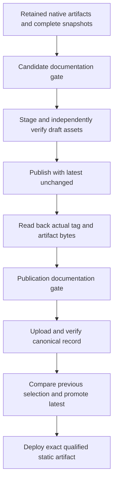

# Website and documentation

## Independent website surfaces

The public website uses Next.js with Fumadocs for its versioned reading shell and Shiki for build-time code highlighting. It has a landing page that introduces the product and a documentation surface that explains version-specific behavior. **WD-01:** The landing page MUST have its own content, layout and navigation entry points outside the versioned documentation source tree. It must be usable without mounting the documentation layout or loading documentation-only search/diagram/highlighting runtimes.

Shared brand tokens, assets and selected components are appropriate. Independent composition does not require separate domains or infrastructure. The landing page can provide product explanation, edition/platform choices, download information, documentation links and support/license access. Its release/download assertions must come from verified release records; absent or unpublished packages must not receive fabricated download destinations.

The website does not provide a mandatory runtime service for local galleries. Native application assets and optional sharing payloads remain governed by their own distribution contracts.

## Documentation sources and routes

**WD-02:** A documentation version MUST have a complete Markdown source snapshot and identifiable navigation order. Each chapter has one semantic topic path. Relative chapter links must resolve within the selected snapshot, rather than accidentally directing readers into the current release.

| Route | Contract |
| --- | --- |
| `/` | Independent landing page |
| `/docs/` | Documentation entry with visible version context |
| `/docs/v0.2.0/` | This baseline's documentation index when published |
| `/docs/<version>/<topic>/` | Stable topic within an explicit retained version |
| `/docs/latest/` | Alias or generated route for the latest published documentation snapshot |

When product releases exist, latest documentation must correspond to the current published product release. A pre-product documentation snapshot must retain its specification context and must not imply downloadable product artifacts. Alias mechanics may use generated static pages or supported routing; the static hosting target must not depend on unsupported server-only redirect behavior.

Source names such as `overview.md` are authored files; rendered topic URLs omit implementation-only source details. The renderer must correctly rewrite chapter, image, fragment and reference links for their versioned output location. The version manifest declares an ordered topic list for each retained snapshot and identifies the selected documentation entry. Snapshot versions and topic identifiers are unique; a build rejects missing chapters or sources.

## Version selection and historical behavior

**WD-03:** Readers MUST be able to choose a retained documentation version. Switching should preserve the current topic when it exists in the target snapshot. If it does not, the UI must explicitly say so and provide the selected version's index or an appropriate mapped topic. It must not silently display latest content beneath an older version label.

Version context must remain visible in navigation and search results. Search must identify its scope, and a result must identify the documentation version it opens. Cross-version links may be explicit, but ordinary within-chapter navigation must not escape a selected snapshot accidentally.

Older documentation describes its corresponding release. Retention is not a promise that every old binary remains supported or that every old settings format can be written by the latest software. Those compatibility claims belong to [verification and compatibility](verification-and-compatibility.md#compatibility-and-version-identity).

## Release-linked build and checks

**WD-04:** Every product release MUST recompile its documentation and check the retained documentation snapshots against the current website build. Checks must cover source rendering, navigation, local links/fragments, static assets, version selection and application-owned JSON references/examples. A previously published snapshot must not disappear because the latest chapter set changed.

The release record must bind software version, documentation snapshot and master application schema version when released together. Historical schema examples must continue to use their matching schema snapshots. Latest aliases and landing downloads must not advance to a candidate before the corresponding publication is verified.

Website build compatibility may require renderer adapters for old Markdown conventions. Such adaptations must preserve the historical meaning. Material corrections to an archived contract require a dated correction record and changelog entry. Renderer compatibility changes may alter presentation while preserving historical meaning; they must not silently rewrite what a release claimed. Historical/version-change prose remains in the master changelog.

## Changelog, JSON and public boundaries

**WD-05:** The site MUST render the master `CHANGELOG.md` and application-owned JSON contracts as readable pages, with source/raw access where appropriate. The changelog has one authored source; avoid divergent manual copies for the landing page and docs. Versioned schema pages must expose their version and structured content, not only offer an opaque download.

The master schema's structure should be rendered generically, including nested objects and composition where used, rather than maintaining a hand-written field list that can drift. A version with no application schema must not receive a fabricated contract. User sidecars are not uploaded into this public reference.

Public navigation must exclude internal planning, issue-tracking artifacts and implementation evidence. Public pages must be understandable without access to private design material, local machine paths or another project's requirements. Build staging and asset-copy operations must honor the brand contract and licenses.

## Accessibility and content quality

**WD-06:** Landing and documentation navigation MUST be keyboard usable and expose meaningful headings, links, focus and version labels. Markdown examples must distinguish specified behavior from commands a user can run. Diagrams explain relationships or meaningful branches; linear procedures use numbered steps. Responsive layouts must preserve navigation and readable code/reference content.

Glossary terms must have precise definitions, primary learning references and relevant local usage links. Major releases require a documentation vocabulary rescan and glossary refresh. A change in site tooling is not permission to change historical product semantics.

## Rendering and snapshot contract

The site uses an independent static Next.js workspace. Markdown-it parses Markdown and tables with raw HTML disabled. Shiki highlights code during the build with governed theme tokens. Copy controls preserve exact source whitespace and communicate success or failure; examples remain readable without scripting. Mermaid diagrams are rendered as strict, described light/dark SVG during preparation with local fonts, unique identifiers and local-only references. They remain readable without scripting, with source disclosure and a local overflow region for legible inspection. Invalid diagrams fail the build; neither Mermaid nor Shiki ships as a reader runtime. The landing page does not import documentation search, diagram or highlighting runtimes.

A validated JSON version manifest inventories ordered retained snapshots/topics and matching schema/examples. Observed canonical GitHub Release records elect the public released versions and current selection; a pending source snapshot does not announce publication. Snapshot-owned assets and captured external brand references retain byte hashes. A build rejects missing or duplicate topics, mismatched schema versions, unsafe links and unpublished local targets. Only inventoried public documents and references are copied into the output; internal planning is excluded.

Search indexes are generated locally from each snapshot's parsed source text. The interface identifies the selected version and limits displayed results to twenty matching chapters. Search unavailability leaves chapter navigation usable. Version changes preserve the topic when available; an unavailable topic opens the selected version's index with an explicit explanation.

Documentation entry and latest aliases are generated static pages with visible version context and explicit-version links. A pre-product baseline remains labelled as a specification. A released latest version requires a matching published release record; candidate records and mismatched artifacts are rejected. Release-linked product promotion remains separate from baseline website publication.

## Reading presentation and discovery

The governed browser AppFrame owns root scrolling. Chapter navigation and the active page contents remain available on wide displays; compact navigation supports keyboard dismissal on narrow displays. Native heading anchors retain fragments and browser history. Reduced motion removes animated scrolling and active-marker transitions. System, light and dark preferences use delivered fonts, semantic colors and remembered explicit selection where storage is available. Prose links retain visible multiline underlines and focus cues.

Each public HTML route has accurate title, description, canonical HTTPS and social metadata. Distinct retained versions are self-canonical; generated entry/latest aliases canonicalize to their explicit equivalent and are omitted from the sitemap. Error pages are not indexed. Governed favicons, manifest dependencies and social artwork are staged byte-for-byte. Metadata never invents package availability, ratings or social identities.

## Publication and recovery

The official website is hosted by GitHub Pages at https://localmedia.gallery. Its custom Actions deployment consumes the exact successfully checked static output after repository, product and website qualification pass. A public deployment identity binds the output to its source revision and digest. Publishing credentials do not rebuild site content; production deployments are serialized and retired revisions are rejected.

Organization Pages domain verification retains its generated TXT record. Repository Pages settings own the canonical apex binding; DNS-only web records follow the current official Pages destinations. Registrar lock, renewal, privacy, DNSSEC and unrelated DNS services remain unchanged. Initial publication does not imply that an installable product exists.

Live acceptance checks authoritative and independent public DNS, trusted HTTPS, HTTP redirection, every retained route and exact static bytes, plus rendered navigation/search/diagrams and mixed content. Provider readiness and qualification are distinct outcomes. Failed or pending checks never become a publication-success assertion. Private provider snapshots and compare-before-restore journals support idempotent reconciliation and recovery; concurrent edits are preserved. Ownership TXT remains during rollback. Permanent retirement or rollback to a different binding withdraws website DNS before unbinding. A provider-documented certificate-provisioning retry may briefly reassign the same organization-verified hostname while retaining its ownership TXT, DNS and deployed Pages site; it requires before/after snapshots and verified restoration.

## Open decisions

U-12 is resolved by these rendering, search, metadata, alias and correction contracts. No further documentation-framework decision remains open for the current site.

Return to the [index](index.md) or consult the [glossary](glossary.md).

## Release snapshots and documentation gates

Each elected version retains complete authored documentation, navigation, assets, master/additional schemas, examples and captured references. Capture inventories sorted relative paths, byte counts and hashes; an exact repeat is idempotent. The capture receipt identifies its source revision and vocabulary review. The later release gate binds that captured content to the exact qualified product revision and current renderer separately, avoiding a self-referential source commit. Material corrections retain dated reasons and old/new snapshot/schema digests with a changelog entry. Public validation follows the complete chronological correction chain from the immutable published identity, rejecting missing, forked, cyclic or unrelated corrections. Ordinary releases require a vocabulary/glossary review; a major release requires the complete term, definition, external primary-reference and local-usage refresh. Review records identify the reviewer, date, notes and exact inspected inventory. Structural checks do not replace editorial judgment.

Every candidate gate recompiles the elected snapshot and every retained version through the current Next.js/Fumadocs/Shiki renderer. It checks rendered prose, routes, links/fragments/assets, raw source hashes, schemas/examples, additional-schema/contract navigation, topic preservation, explicit missing-topic fallback and version-scoped search. Actual headless browser acceptance exercises the exported interface. The receipt binds the immutable release candidate, product source, all snapshot inputs, current renderer, exported output and complete check outcomes. Changed renderer, snapshot, artifact identity or output invalidates authorization. Candidate qualification keeps current aliases/downloads unchanged.

After the service confirms publication and matching artifact bytes, a second private build qualifies the observed published projection. Only this matching receipt permits canonical release-record and latest promotion. The public builder resolves actual canonical releases and rejects fixture, candidate, missing or mismatched identities. It includes verified historical versions and retains the explicitly labelled specification baseline. Selected downloads and latest aliases derive from the same publication identity.

Pages deployment verifies the retained static inventory, renderer revision and current canonical publication selection. A queued build whose release selection has become stale refuses deployment, even when its renderer commit still matches main. Publishing credentials deploy the retained output without rebuilding it. Failed candidate runs retain previous public pointers; an observed release whose promotion failed remains distinct from a current download.
